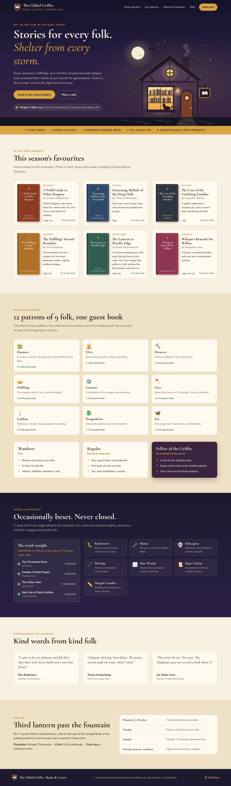
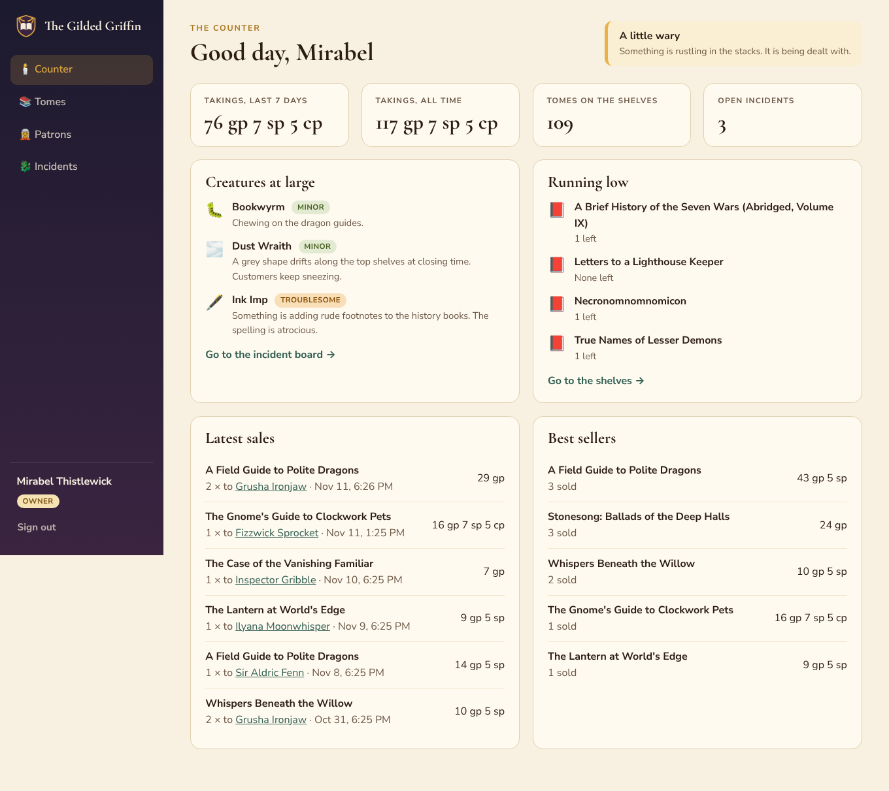
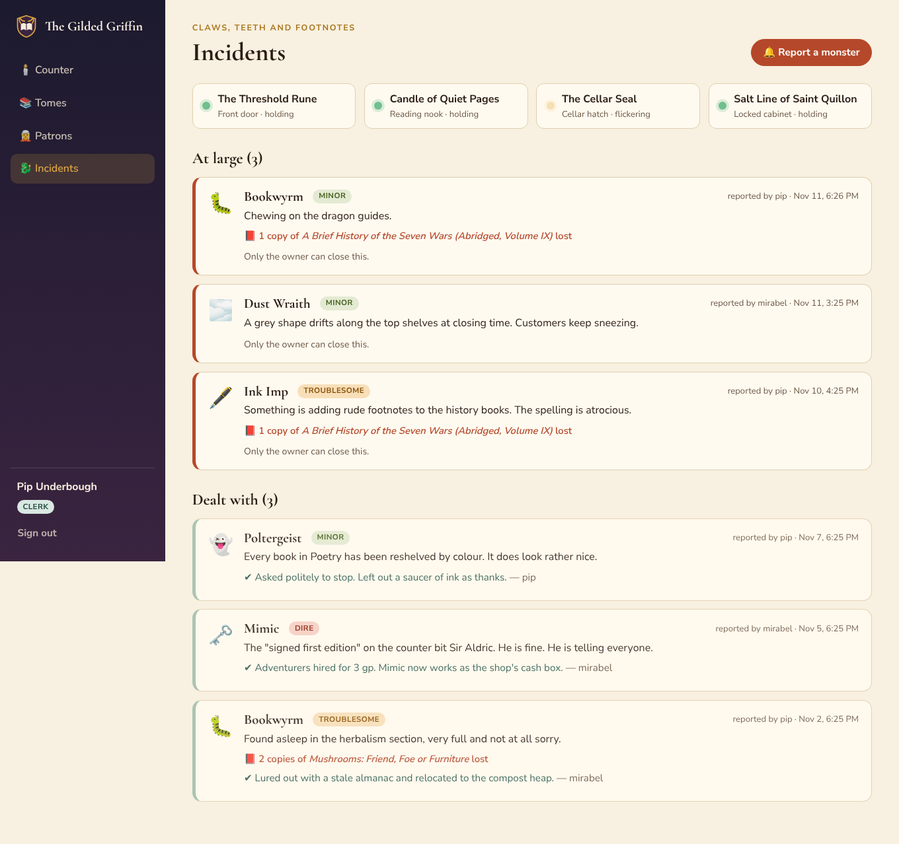
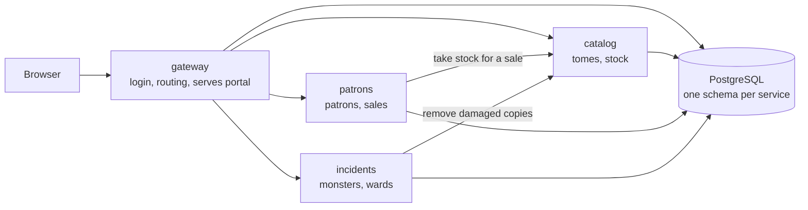

# The Gilded Griffin

A management portal for a cozy bookstore in the fantasy town of Emberhollow. Patrons of every folk buy tomes; monsters occasionally eat them.

It is a small, complete example of the kind of system we usually build: a web portal, a gateway with login, three microservices and a database. It exists as the starting codebase for an SDLC hyperfactory demonstration, so it is deliberately a working skeleton with room to grow (see the [backlog](docs/backlog.md)). The reasons and the goals are in [docs/purpose.md](docs/purpose.md).

| The shop front | The counter | The incident board |
|---|---|---|
|  |  |  |

## Run it

### In your browser, nothing to install (GitHub Codespaces)

1. On the repository page, choose **Code → Codespaces → Create codespace**.
2. Wait a few minutes while it builds and starts the shop.
3. The site opens by itself. If it does not, open the **Ports** tab and click the globe next to port 8080.

### On your own machine (Docker)

With [Docker Desktop](https://www.docker.com/products/docker-desktop/) running:

```bash
docker compose up --build
```

Then open http://localhost:8080.

Other ways to deploy, including a public URL, are in [docs/deployment.md](docs/deployment.md).

## Sign in

The landing page is public. The **Staff door** leads to the management portal.

| Who | Name | Password | Can do |
|---|---|---|---|
| Mirabel Thistlewick, owner | `mirabel` | `griffin` | Everything, including prices, takings, membership tiers and resolving incidents |
| Pip Underbough, clerk | `pip` | `quill` | Sell and restock tomes, register patrons, report monsters |

## What is in the box

| Fantasy | Software |
|---|---|
| Tomes on shelves | Product catalog and inventory (`services/catalog`) |
| Patrons and their purchases | Customers and orders (`services/patrons`) |
| Monster incidents and wards | Incident management (`services/incidents`) |
| The staff door | Login, roles and API routing (`services/gateway`) |
| The shop front and counter | React web portal (`apps/portal`) |



More detail: [purpose](docs/purpose.md) · [story](docs/story.md) · [architecture](docs/architecture.md) · [API](docs/api.md) · [personas](docs/personas.md) · [backlog](docs/backlog.md) · [deployment](docs/deployment.md)

## Develop

Requires Node 22 and Docker.

```bash
npm install
```

```bash
npm run db:up
```

```bash
npm run dev
```

`npm run dev` starts all four services with live reload and the portal at http://localhost:5173.

| Command | What it does |
|---|---|
| `npm test` | Runs every test. Needs the database from `npm run db:up`; tests use a separate `griffin_test` database |
| `npm run lint` | ESLint |
| `npm run typecheck` | TypeScript, no output |
| `npm run build` | Builds everything |

Everything is TypeScript. Money is stored as whole copper pieces: 1 gold piece = 10 silver = 100 copper.
