# Architecture

The Gilded Griffin is a web portal backed by a gateway, three microservices and one PostgreSQL database. This document describes how the pieces fit, what they are built with, and the decisions behind them.

**Contents:** [At a glance](#at-a-glance) · [Tech stack](#tech-stack) · [System context](#system-context) · [Components](#components) · [Inside a service](#inside-a-service) · [Data model](#data-model) · [Request flows](#request-flows) · [Security](#security) · [Deployment](#deployment) · [Build and test pipeline](#build-and-test-pipeline) · [Repository layout](#repository-layout) · [Decisions](#decisions-worth-knowing) · [Known gaps](#known-gaps)

## At a glance

| Piece | Folder | Port | Owns | Database schema |
|---|---|---|---|---|
| Portal | `apps/portal` | 5173 in development | The landing page and the staff screens | none |
| Gateway | `services/gateway` | 8080 | Staff accounts, login, routing | `auth` |
| Catalog service | `services/catalog` | 4001 | Tomes, stock levels, the stock ledger | `catalog` |
| Patrons service | `services/patrons` | 4002 | Patrons, sales | `patrons` |
| Incidents service | `services/incidents` | 4003 | Monster incidents, wards | `incidents` |
| Shared library | `packages/shared` | | Code every service needs | none |

The browser only ever talks to the gateway. In production the gateway also serves the portal's files, so the whole shop is one address.

## Tech stack

Everything is TypeScript, in one repository managed with npm workspaces.

| Layer | Technology | Version | Used for |
|---|---|---|---|
| Language | TypeScript | 6 | All services, the shared library and the portal |
| Runtime | Node.js | 22 | Running the services |
| Front end | React | 19 | The portal's screens |
| | React Router | 7 | Page navigation inside the portal |
| | Vite | 8 | Development server and production build of the portal |
| | Plain CSS | | Styling, in `apps/portal/src/styles`. No CSS framework |
| | Fontsource | 5 | Self-hosted fonts (Cormorant Garamond, Nunito Sans) |
| API | Fastify | 5 | The web framework for all four services |
| | zod | 4 | Checking every incoming request |
| | `@fastify/http-proxy` | 11 | The gateway forwarding requests to services |
| | `@fastify/static` | 10 | The gateway serving the built portal |
| Security | jsonwebtoken | 9 | Signing and verifying staff tokens (JWT) |
| | Node `crypto` (scrypt) | built in | Hashing passwords |
| Data | PostgreSQL | 16 | The database |
| | node-postgres (`pg`) | 8 | Database access with hand-written SQL. No ORM |
| | SQL migration files | | Schema changes, applied by a small runner in the shared library |
| Testing | Vitest | 5 | Unit tests and API tests against a real test database |
| Code quality | ESLint with typescript-eslint | 10 / 8 | Linting |
| Packaging | Docker, Docker Compose | | One Dockerfile builds every service; Compose runs the whole shop |
| Pipeline | GitHub Actions | | Lint, typecheck, test and build on every pull request |
| Hosting options | GitHub Codespaces, Docker Compose, Render | | See [deployment.md](deployment.md) |

## System context

Who uses the system and what it depends on.

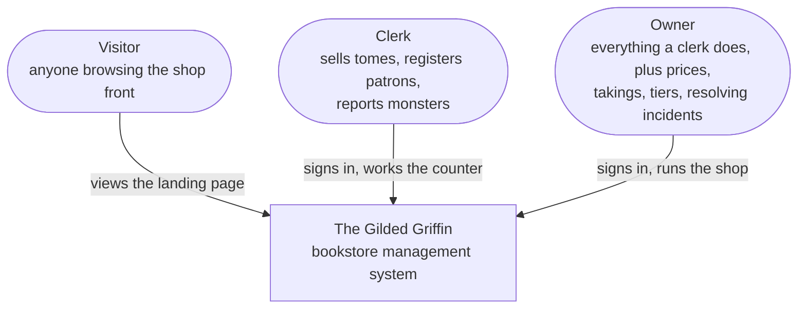

There are no external systems yet: no payment provider, email or supplier integration. Several [backlog](backlog.md) items would add one.

## Components

The deployable pieces and how they talk to each other. Every arrow is JSON over HTTP unless it points at the database.

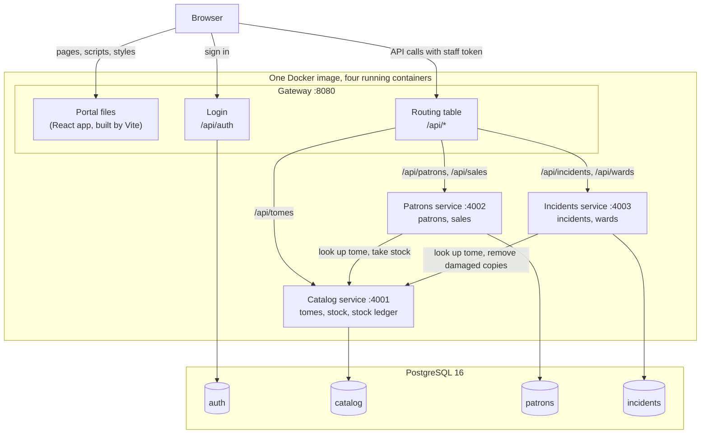

Points to notice:

- **The gateway is the only public door.** The three services are not exposed outside the Docker network.
- **The catalog is the only service other services call.** Patrons and incidents both need to change stock, and they do it through the catalog's API, never its tables.
- **Each service has its own schema.** No arrow crosses from one service to another service's schema.

### The gateway's routing table

Defined in `routingTable` in `services/gateway/src/app.ts`.

| Path through the gateway | Goes to | Path on that service |
|---|---|---|
| `/api/auth/*` | handled by the gateway itself | |
| `/api/tomes` | catalog | `/tomes` |
| `/api/patrons` | patrons | `/patrons` |
| `/api/sales` | patrons | `/sales` |
| `/api/incidents` | incidents | `/incidents` |
| `/api/wards` | incidents | `/wards` |
| `/api/public/tomes` | catalog | `/public/tomes` |
| `/api/public/patron-stats` | patrons | `/public/patron-stats` |
| `/api/public/shop-status` | incidents | `/public/shop-status` |
| anything else | the portal's `index.html` | |

The full list of endpoints is in [api.md](api.md).

### The portal

A single-page React application.

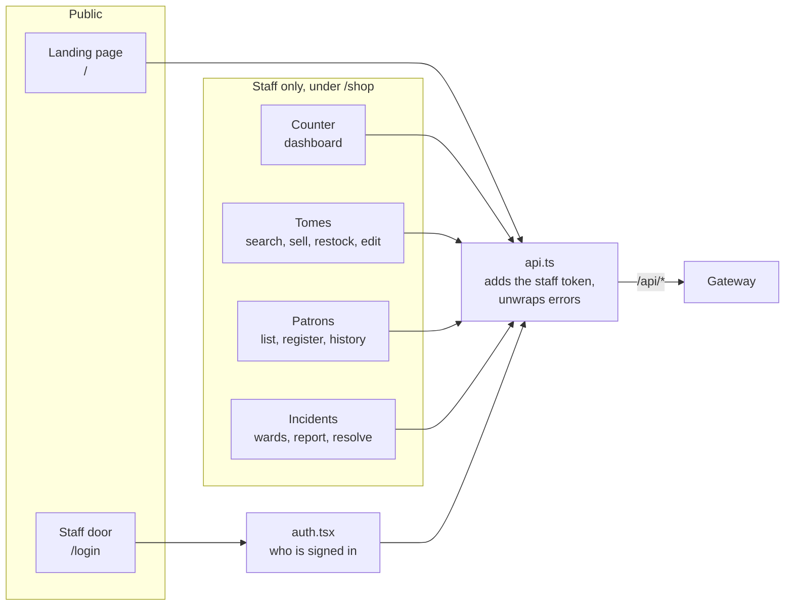

The portal does not import code from the services. It depends only on the API, with its own copy of the response types in `src/types.ts`.

## Inside a service

The catalog, patrons and incidents services share one shape, so learning one teaches you all three.

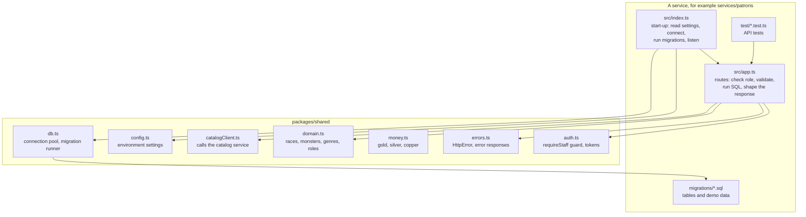

Each route in `app.ts` follows the same four steps:

1. **Guard**: `requireStaff` checks the token and the role.
2. **Validate**: a zod schema checks the request.
3. **Act**: SQL against the service's own schema, and where needed a call to the catalog.
4. **Respond**: JSON in camelCase, or an `HttpError` with the right status code.

`buildApp` receives its database and catalog client as arguments. Tests use this to pass in the test database and a fake catalog.

## Data model

One PostgreSQL database with four schemas. Solid lines are real foreign keys inside a schema. Dotted lines are references across services, stored as plain numbers with no foreign key.

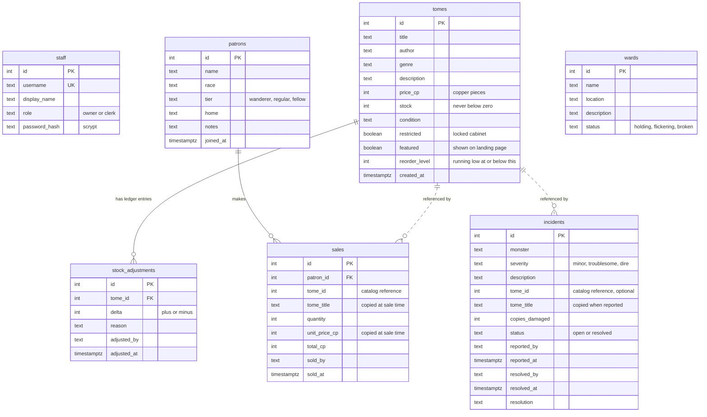

| Schema | Owner | Tables |
|---|---|---|
| `auth` | gateway | `staff` |
| `catalog` | catalog service | `tomes`, `stock_adjustments` |
| `patrons` | patrons service | `patrons`, `sales` |
| `incidents` | incidents service | `incidents`, `wards` |

Each schema also has a `schema_migrations` table recording which migration files have run.

Rules that hold across the model:

- **Money is whole copper pieces.** 1 gold piece = 10 silver = 100 copper. No fractions are ever stored.
- **Sales and incidents keep their own copy** of the tome's title and price, so history stays correct if the catalog changes later.
- **Staff are recorded by username** (`sold_by`, `reported_by`, `adjusted_by`), not by id, for the same reason.

## Request flows

### Signing in

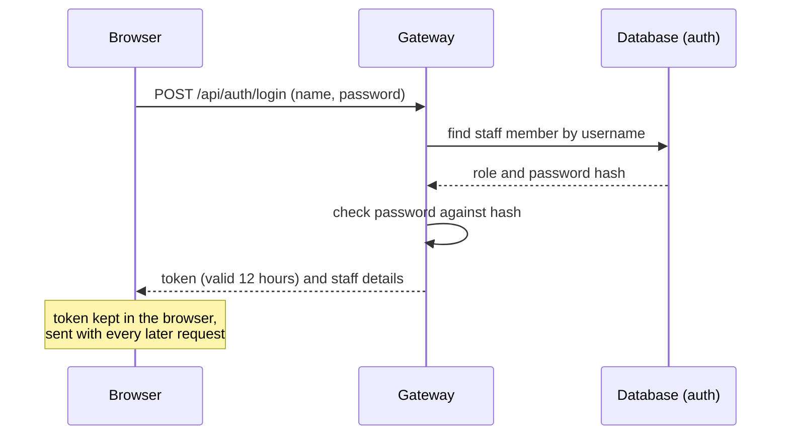

### Selling a tome

Two services cooperate: the catalog guards the stock, the patrons service records the sale.

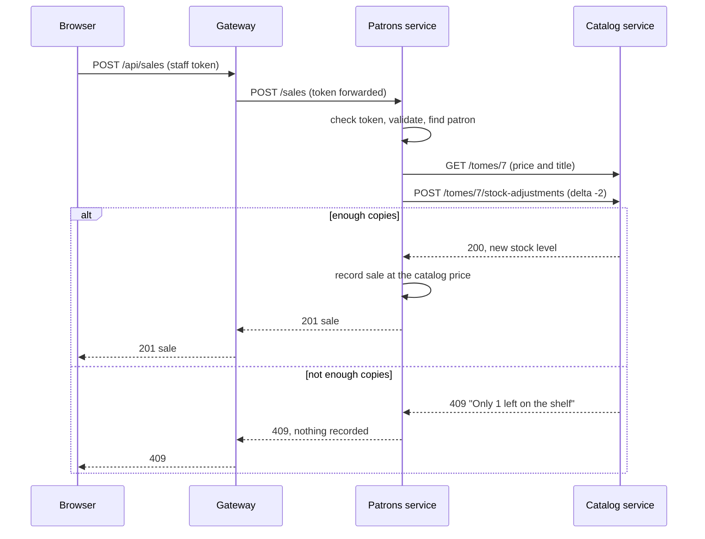

### Reporting a monster

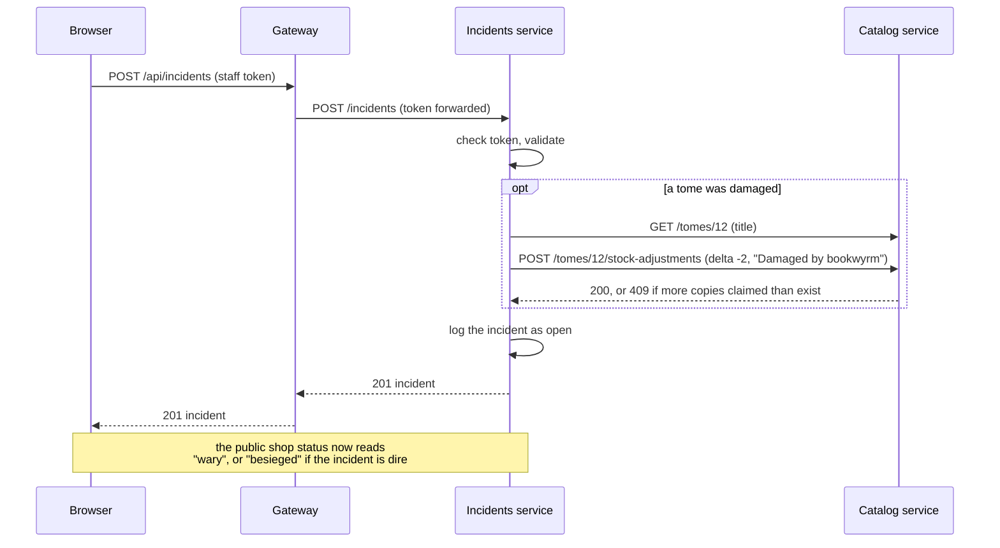

## Security

### How login works

- The gateway holds the staff accounts. Passwords are stored as scrypt hashes with a random salt, never as plain text.
- A successful login returns a signed token (JWT) carrying the staff member's id, username, display name and role. It expires after 12 hours.
- The gateway forwards the token unchanged. **Every service verifies it again** with the shared `JWT_SECRET`, so a service does not trust a caller just for being on the internal network.
- When one service calls another, it forwards the same token, so the catalog knows which staff member a stock change is for.

### Who can do what

Enforced by the services. The portal hides controls a role cannot use, but that is a courtesy, not the protection.

| Action | Visitor | Clerk | Owner |
|---|---|---|---|
| View landing page, featured tomes, shop status, patron counts | ✔ | ✔ | ✔ |
| Browse and search tomes | | ✔ | ✔ |
| Sell a tome, restock, view stock ledger | | ✔ | ✔ |
| Add or edit a tome, change its price | | | ✔ |
| View and register patrons, see purchase history | | ✔ | ✔ |
| Change a patron's membership tier or notes | | | ✔ |
| View takings and best sellers | | | ✔ |
| View and report incidents, view wards | | ✔ | ✔ |
| Resolve an incident | | | ✔ |

### What the public can see

Routes under `/public/` need no login and are written to expose no personal data: featured, unrestricted tomes; patron counts by race with no names; ward status and a count of open incidents.

### What is not covered

This is a demonstration system. The demo passwords are printed on the login page, there is no rate limiting on sign-in, no password change, and the default `JWT_SECRET` is a placeholder. See [Known gaps](#known-gaps) and [deployment.md](deployment.md) before putting it anywhere public.

## Deployment

All services are built into **one Docker image**. The `SERVICE` environment variable chooses which service a container runs.

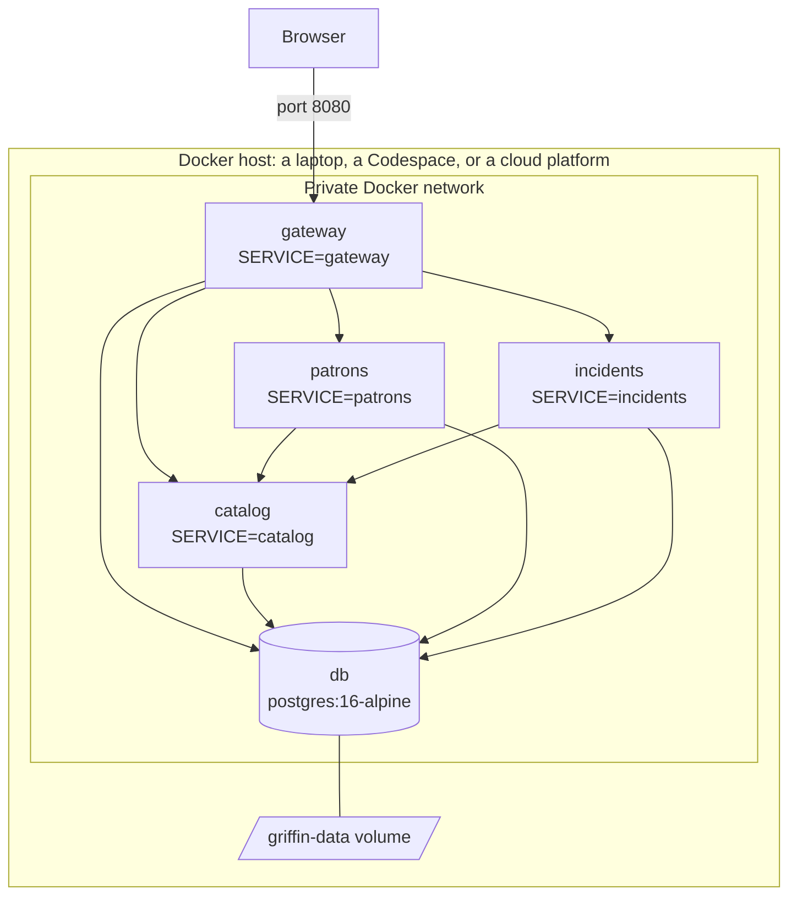

- Only the gateway's port 8080 is published. In Docker Compose the database's port 5432 is also published so tests and tools on the host can reach it.
- On start-up each service applies its own outstanding migrations, then starts listening. The gateway also creates the two staff accounts if they do not exist.
- Data lives in the `griffin-data` volume. `docker compose down -v` wipes it; the next start recreates the demo data.

The same image runs in all three hosting options. Step-by-step instructions and the settings table are in [deployment.md](deployment.md).

### Development mode

`npm run dev` runs the same pieces without Docker (apart from the database), with live reload.

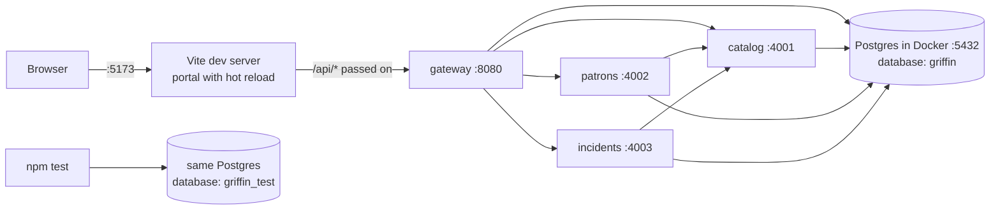

## Build and test pipeline

Defined in `.github/workflows/ci.yml`. It runs on every pull request and on every push to `main`.

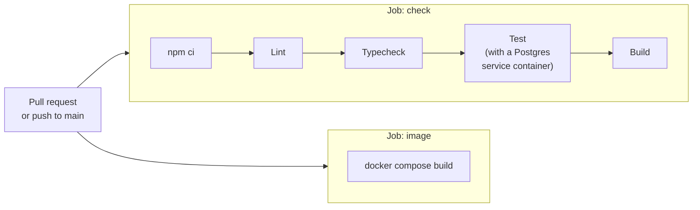

How the tests are organised:

| Kind | Where | What it checks |
|---|---|---|
| Unit | `packages/shared/src/*.test.ts`, `services/incidents/test/shopMood.test.ts`, `apps/portal/src/money.test.ts` | Pure logic: money, tokens, shop mood |
| API | `services/*/test/*.test.ts` | Each route, through Fastify's `inject`, against the real `griffin_test` database, as both owner and clerk |
| Cross-service | inside the patrons and incidents API tests | Behaviour when the catalog accepts or refuses, using a fake catalog client |

There is no automated browser test yet.

## Repository layout

```
.
├── apps/
│   └── portal/              React portal
│       └── src/
│           ├── pages/       Landing, Login, Dashboard, Tomes, Patrons, Incidents
│           ├── components/  Layout, modal, book cover, shop-front illustration
│           ├── styles/      theme.css, landing.css, shop.css
│           ├── api.ts       Calls the gateway
│           ├── auth.tsx     Who is signed in
│           ├── types.ts     API response shapes
│           └── lore.ts      Display text for races, monsters, tiers
├── services/
│   ├── gateway/             Login, routing, serves the portal
│   ├── catalog/             Tomes and stock
│   ├── patrons/             Patrons and sales
│   └── incidents/           Monsters and wards
│       ├── src/app.ts       Routes
│       ├── src/index.ts     Start-up
│       ├── migrations/      SQL: tables and demo data
│       └── test/            API tests
├── packages/
│   └── shared/              Auth guard, database, errors, money, domain lists
├── docker/                  Dockerfile, test database set-up
├── docs/                    This document, API, backlog, deployment
├── .devcontainer/           GitHub Codespaces configuration
├── .github/workflows/       CI pipeline
├── docker-compose.yml       Runs the whole shop
├── render.yaml              Render blueprint
└── CLAUDE.md                Conventions for coding agents
```

## Decisions worth knowing

| Decision | Why | Trade-off |
|---|---|---|
| One database, one schema per service | Cheap and simple to run for a demo, while keeping the rule that a service touches only its own tables | Services share one database's capacity and downtime. Splitting later means moving a schema, not untangling tables |
| No foreign keys across services; title and price copied into sales and incidents | Services stay independent, and history survives catalog changes | A sale can point at a tome id that no longer exists |
| A gateway in front of everything | One address for the browser, one place for login and routing | One more hop, and one piece whose failure takes everything down |
| Every service verifies the token itself | No service trusts the network | All services must share `JWT_SECRET` |
| Stock changes only through the catalog's adjustment endpoint | One atomic check-and-update means two sales at once cannot oversell, and every change is in the ledger | Other services depend on the catalog being up to sell or log damage |
| Hand-written SQL, no ORM | Readable by anyone who knows SQL; nothing hidden | More typing for each query |
| Migrations run at service start-up; demo data is a migration | A fresh database comes up ready to use with no extra step | Not how you would seed a production system |
| One Docker image for all services | One build, simpler deployment | Changing one service rebuilds the image for all |
| The portal keeps its own copy of the API types | The portal depends only on the API contract, not on service code | Types can drift; generating them is a backlog item |

## Known gaps

These are deliberate, to leave room for the [backlog](backlog.md):

- A sale takes stock and then records the sale as two steps. If the second fails, stock is not put back.
- No loans, late fees, discounts or loyalty points.
- Wards are read-only.
- No audit trail of who changed a tome, no password change, no login rate limiting.
- The portal's API types are maintained by hand rather than generated.
- No automated browser tests.
- No external integrations (payments, email, suppliers).
