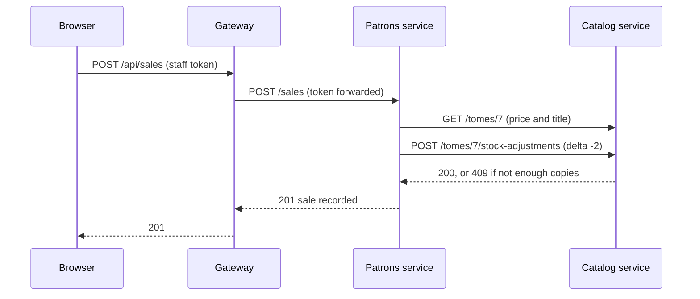

# Architecture

## The pieces

| Piece | Port | Owns | Technology |
|---|---|---|---|
| Portal (`apps/portal`) | 5173 in dev | The landing page and the staff screens | React, Vite |
| Gateway (`services/gateway`) | 8080 | Staff accounts, login, routing | Fastify, Postgres schema `auth` |
| Catalog (`services/catalog`) | 4001 | Tomes, stock levels, the stock ledger | Fastify, Postgres schema `catalog` |
| Patrons (`services/patrons`) | 4002 | Patrons, sales | Fastify, Postgres schema `patrons` |
| Incidents (`services/incidents`) | 4003 | Monster incidents, wards | Fastify, Postgres schema `incidents` |
| Shared library (`packages/shared`) | | Code every service needs | TypeScript |

The browser only ever talks to the gateway. In production the gateway also serves the portal's files, so the whole shop is one address.

## How a request flows

Selling two copies of a tome:

Reporting a monster that damaged stock follows the same pattern from the incidents service.

## Decisions worth knowing

- **One database, one schema per service.** Cheap to run for a demo, while keeping the rule that a service touches only its own tables. Cross-service references (a sale's `tome_id`) are plain numbers with no foreign key, and the title and price are copied in at the time.
- **Login.** The gateway checks the password (stored as a scrypt hash) and issues a signed token (JWT, 12 hours) carrying the staff member's role. Every service verifies the token itself using the shared `JWT_SECRET`, so no service trusts a caller just because it is on the internal network.
- **Roles.** `owner` and `clerk`. Routes are either open to any staff member or owner-only; see [api.md](api.md).
- **Stock is changed in one place.** Only the catalog's stock-adjustment endpoint changes stock. It checks and updates in a single statement, so two sales at once cannot oversell, and it writes each change to a ledger table.
- **Migrations.** Each service applies its own numbered SQL files at start-up. Demo data is a migration, so a fresh database comes up populated. Staff accounts are created by the gateway at start-up.
- **One Docker image.** All services are built into one image; the `SERVICE` environment variable picks which one a container runs.

## Known gaps

These are deliberate, to leave room for the backlog:

- A sale takes stock and then records the sale as two steps. If the second fails, stock is not put back.
- No loans, late fees, discounts or loyalty points.
- Wards are read-only.
- No audit trail of who changed a tome, no password change, no login rate limiting.
- The portal's API types are maintained by hand rather than generated.
