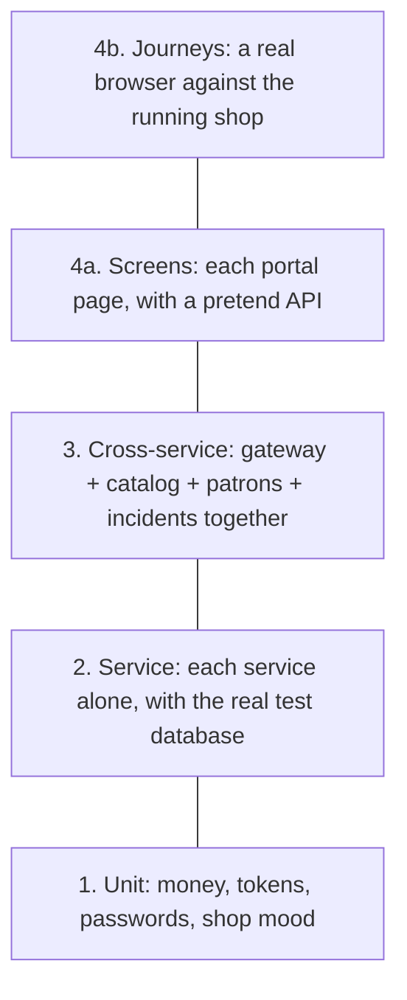

# Testing

How the shop is tested, and how to run the tests. Written for anyone on the team; no testing experience is assumed.

## Why there are four kinds of test

Each kind answers a different question. The quick ones run constantly and catch most mistakes; the slow ones run less often and catch what only shows up when everything is connected.

| Kind | The question it answers | How long it takes | How many |
|---|---|---|---|
| **1. Unit** | Does this one piece of logic give the right answer? | Milliseconds | About 60 |
| **2. Service** | Does each service obey its rules: who is allowed, what is refused, what is stored? | A few seconds | About 250 |
| **3. Cross-service** | Do the gateway and the three services work together? | A few seconds | About 30 |
| **4. Screens and journeys** | Does the portal show the right thing, and can staff actually do their jobs in a browser? | Seconds for screens, about 20 seconds for journeys | About 100 screen tests, 22 journeys |



Fewer tests at the top, more at the bottom. A mistake should be caught by the lowest, fastest layer that can catch it.

## Running them

Start the database first (once per session):

```bash
npm run db:up
```

Layers 1 to 4a, about half a minute:

```bash
npm test
```

The same, with a report of how much of the code the tests exercised:

```bash
npm run test:coverage
```

Layer 4b, the browser journeys. These need the whole shop running, so start it in one terminal:

```bash
docker compose up --build
```

and run the journeys in another:

```bash
npm run test:e2e
```

The first time, the browser the journeys drive has to be downloaded:

```bash
npx playwright install chromium
```

To test a shop running somewhere else, set `E2E_BASE_URL`, for example `E2E_BASE_URL=https://my-shop.example npm run test:e2e`. The journeys add tomes, patrons and incidents with unique names. They leave the demo data alone but do not tidy up after themselves; `docker compose down -v` gives you a fresh shop.

## What each layer covers

### 1. Unit tests

Small pieces of logic with no database and no network.

| Where | What |
|---|---|
| `packages/shared/src/*.test.ts` | Money (gold, silver, copper), staff tokens and their twelve-hour life, the `requireStaff` guard, the shape of error responses, the client that calls the catalog, environment settings |
| `services/gateway/test/staff.test.ts` | Password hashing, the demo staff accounts |
| `services/incidents/test/shopMood.test.ts` | Calm, wary or besieged |
| `apps/portal/src/money.test.ts`, `lore.test.ts` | Typed gold turned into copper; the portal's hand-kept lists of genres, races and monsters match the services' |

### 2. Service tests

Each service on its own, called through Fastify's `inject` (a request without a network), storing data in the real `griffin_test` database. The catalog is replaced by a fake when testing patrons and incidents.

Every service has the same three files, so you always know where to look:

| File | What |
|---|---|
| `test/access.test.ts` | **Who may use each route.** A table lists every route as open to anyone, to staff, or to the owner alone, and each is tried as a visitor, as the clerk and as the owner. A new route with no entry fails the test. The same file tries the edge of every rule: a price of -1, a sale of 100 copies, a blank name |
| `test/<service>.test.ts` | **The business rules.** Stock can never go below zero, even when ten tills ring at once. A tome is running low when its stock is at or below its own reorder level. A refused sale records nothing. The takings count only the last seven days. An incident cannot be resolved twice |
| `test/seed.test.ts` | **The demo data.** The database can be built from empty, and the demo rows only use genres, races and monsters the shop knows |

The gateway also has `test/routing.test.ts`, which stands up three stand-in services and checks every entry in the routing table: the request reaches the right service, on the right path, with the staff token untouched.

### 3. Cross-service tests

In `tests/integration`. The gateway and all three services run together in one process, talking to each other over real HTTP, exactly as in production but without Docker or a browser.

| File | What |
|---|---|
| `shop.test.ts` | Ringing up a sale takes the copies off the catalog's shelf, writes the ledger and adds to the owner's takings. A monster report removes damaged copies and changes the public mood until the owner resolves it. The clerk is kept out of owner business in every service |
| `catalogContract.test.ts` | The fake catalog used in layer 2 answers the same way as the real one. If either changes, this fails, so the fake cannot quietly drift |
| `portalTypes.test.ts` | The portal's hand-written types (`apps/portal/src/types.ts`) match what the API really sends |

### 4a. Screen tests

In `apps/portal/src`, next to the code they test. Each portal page is drawn in a pretend browser (jsdom) with the API replaced by canned answers (`src/test/harness.tsx`, `src/test/fixtures.ts`). They check what the page shows, what it sends when a form is submitted, and above all **what each role sees**: the clerk has no price editing, no takings and no way to close an incident, and the portal does not even ask the API for the takings on the clerk's behalf.

### 4b. Journeys

In `tests/e2e/journeys`, one file per kind of person, following [personas.md](personas.md). A real browser (Chromium, driven by Playwright) is pointed at the running shop.

| File | Journeys |
|---|---|
| `visitor.spec.ts` | Sees the shop window, guest-book count and mood without signing in; is turned back at the staff door; an automated accessibility scan of the shop front and login page |
| `clerk.spec.ts` | Pip signs in, registers a patron, rings up a sale, is told when another till sold the last copies, takes a delivery, reports a monster, and has no owner controls |
| `owner.spec.ts` | Mirabel adds a tome to the shop window, reprices and locks one away, sets a reorder level and sees the counter warn about it, promotes a patron, deals with an incident, sees the takings rise by exactly the value of a sale, and signs out |

The visitor journey also checks that reorder levels stay off the public shop window.

## What runs automatically

Every pull request and every push to `main` (`.github/workflows/ci.yml`):

| Job | Steps |
|---|---|
| **check** | Lint, typecheck, layers 1 to 4a with coverage, build, a scan of dependencies for known high-severity vulnerabilities |
| **e2e** | Builds the Docker image, starts the whole shop with `docker compose up`, runs the journeys. If a journey fails, the report with screenshots is kept for download |

Coverage has a floor: 90% of lines in `packages/shared`, 85% in each service, 70% in the portal. The floor stops coverage sliding backwards. It is not the goal; a test is worth having when it would catch a real mistake.

## Adding tests with a change

| If you change | Add or update |
|---|---|
| A route | Its row in that service's `test/access.test.ts`, and the rule in `test/<service>.test.ts`, for both roles where they differ |
| Something two services do together | `tests/integration/test/shop.test.ts` |
| What the catalog tells other services | `fakeCatalog` in `packages/shared/src/testing.ts` and `tests/integration/test/catalogContract.test.ts` |
| A field the portal reads | `apps/portal/src/types.ts` and the matching schema in `tests/integration/test/portalTypes.test.ts` |
| A portal page | The page's `*.test.tsx`, including what the clerk must not see |
| Something a person does from start to finish | A journey in `tests/e2e/journeys` |

Shared helpers: `staffHeaders('owner')`, `fakeCatalog()` and `listRoutes(app)` in `packages/shared/src/testing.ts`; `openShop()` in `tests/integration/test/shop.ts`; `pretendApi()` and `openPortal()` in `apps/portal/src/test/harness.tsx`; `signIn()` and `backstage()` in `tests/e2e/journeys/shop.ts`.

## Known gaps

Written into the tests as `todo` entries, so they show in every test run:

- A sale is not all-or-nothing: if recording the sale fails after the catalog has taken the copies, the stock is not put back ([backlog](backlog.md) item 14). The same is true of an incident report with damaged copies.

Deliberately not tested: load and performance, security penetration, pixel-by-pixel appearance, and the `trailer/` folder.
